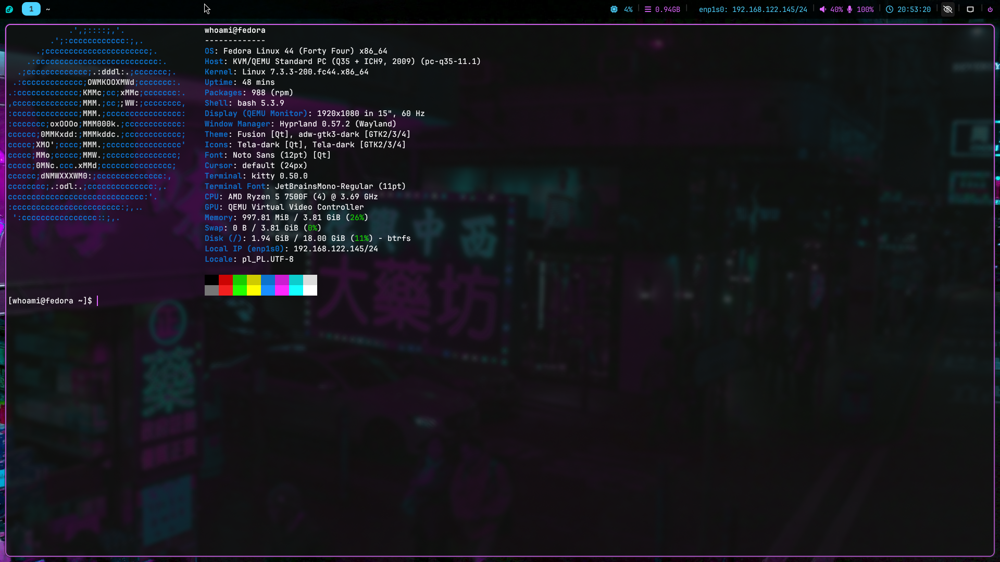
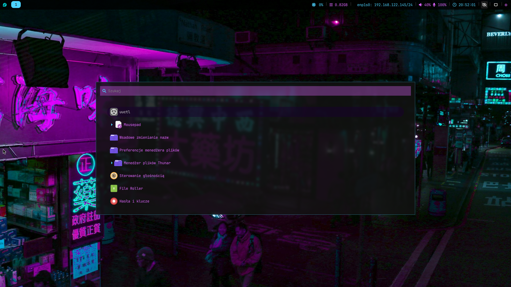
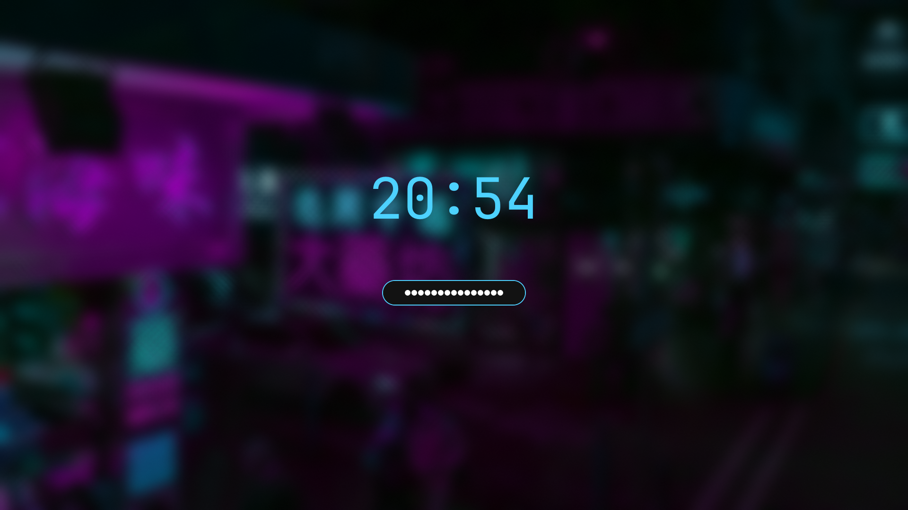
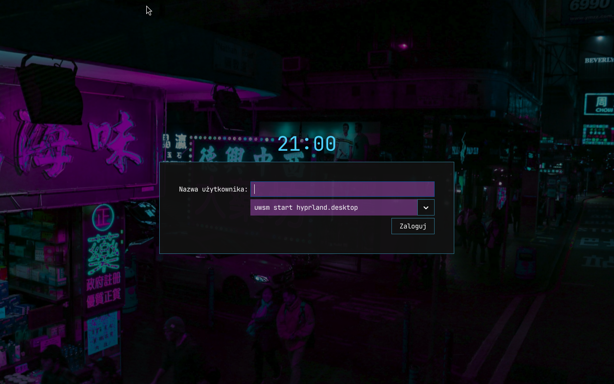

<div align="center">
<h1>My Linux Desktop Dotfiles</h1>
<p>My Linux configuration files (dotfiles) for Hyprland!</p>
</div>

Hyprland config written in Lua, started through uwsm, with greetd + gtkgreet as the login screen. Also in here: waybar, wofi, dunst, hyprlock, hypridle, kitty, the Tela icon theme and qt5ct/qt6ct for Qt apps.

<h2 align="center">Screenshots</h2>

<table>
  <tr>
    <td align="center" width="50%">
      <br>
      Desktop with kitty and waybar
    </td>
    <td align="center" width="50%">
      <br>
      The wofi application launcher
    </td>
  </tr>
  <tr>
    <td align="center" width="50%">
      <br>
      Lock screen (hyprlock)
    </td>
    <td align="center" width="50%">
      <br>
      Login screen (greetd + gtkgreet)
    </td>
  </tr>
</table>

Wallpaper credit is in Credits below.

<h2 align="center">Supported systems</h2>

- **Fedora 44**: tested (see `TESTED_FEDORA_VERSIONS` in `install.sh`). Other Fedora versions only get a warning, the script still runs. Atomic variants (Silverblue, Kinoite, ...) are not supported, because `dnf` cannot install packages there.
- **Arch Linux**: support is planned. For now the script only copies the config files: no packages, no services, and no guarantee that everything works.
- Anything else: the script stops with an error.

<h2 align="center">Installation</h2>

```bash
git clone https://github.com/lvkaszus/dotfiles.git
cd dotfiles
chmod +x install.sh   # only if it is not executable yet
./install.sh
```

Don't run it as root, it uses `sudo` where needed. The script asks for confirmation first and then does this:

1. Enables the `lionheartp/Hyprland` COPR (a third-party repo) and installs the packages from `packages/fedora.txt`. The optional apps from `packages/fedora-apps.txt` are asked about separately.
2. Creates the user directories (`xdg-user-dirs-update`) and refreshes the font cache.
3. Copies the dotfiles from `home/lvkaszus/` to `$HOME`.
4. Installs the greetd/gtkgreet files to `/etc` and `/usr`, and the wallpaper.
5. Restores SELinux labels (`restorecon`) for `/etc/greetd` and `/usr/share/locale/pl`, if `restorecon` is available.
6. Clones the Tela icon theme from GitHub and installs it for your user.
7. Enables greetd, sets the graphical target as default and enables the user services (pipewire, pipewire-pulse, wireplumber, hypridle, hyprpolkitagent, gnome-keyring).

When it's done, reboot and log in through gtkgreet with your password. Enjoy! 😄️

<h2 align="center">Options</h2>

| Option             | What it does                                                                             |
| ------------------ | ---------------------------------------------------------------------------------------- |
| `-y`, `--yes`      | Don't ask for confirmation. Installs the optional apps too, unless `--no-apps` is given. |
| `-n`, `--dry-run`  | Print what would be done without changing anything.                                      |
| `--no-apps`        | Skip the optional apps from `packages/<distro>-apps.txt`.                                |
| `--wallpaper PATH` | Use this wallpaper file instead of asking for one (`--wallpaper=PATH` works too).        |
| `--no-wallpaper`   | Don't install any wallpaper.                                                             |
| `-h`, `--help`     | Show the help.                                                                           |

Examples:

```bash
./install.sh --dry-run                      # see what it would do
./install.sh -y --no-apps                   # unattended, without the optional apps
./install.sh --wallpaper ~/Downloads/bg.jpg # use your own wallpaper
```

<h2 align="center">Wallpaper</h2>

The wallpaper is installed as `Wallpaper.jpg` in your Pictures directory. The directory is detected with `xdg-user-dirs`, so it can be `~/Pictures`, `~/Obrazy` and so on. hyprpaper and hyprlock read it from there, and the script also copies it to `/etc/greetd/gtkgreet-background.jpg` for the login screen.

Pass the source with `--wallpaper PATH`, otherwise the script asks (just press Enter if the file is already in place). With `-y` it uses whatever is already there. If the file is missing it only warns, so you can re-run with `--wallpaper PATH` later.

The configs in the repo point to `~/Pictures/Wallpaper.jpg`. If your Pictures directory is somewhere else, the script rewrites that path in `hyprpaper.conf` and `hyprlock.conf` while deploying.

The wallpaper itself isn't included in this repo.

<h2 align="center">Backups and rewritten paths</h2>

Files that get replaced are backed up first to `~/.dotfiles-backup/<date>-<time>/`, keeping their original paths. Files that are identical to the repo version aren't backed up.

The Qt configs (`qt5ct.conf`, `qt6ct.conf`) have `/home/lvkaszus` hardcoded in `color_scheme_path`, because Qt doesn't expand `$HOME` or `~` there. The script swaps it for your real home directory while copying.

<h2 align="center">Keyring</h2>

`gnome-keyring` with `gnome-keyring-pam` unlocks the login keyring with your login password, so Thunar can remember saved passwords (Samba shares and so on). That only works when you log in through gtkgreet with a password.

<h2 align="center">Customizing</h2>

- Login screen: `/etc/greetd/gtkgreet.css`. Box transparency is the `alpha(@bgcolor, ...)` value, the wallpaper dimming is the black `rgba` layer at the top.
- Lock screen: `~/.config/hypr/hyprlock.conf` (clock, input field, wallpaper blur and brightness).
- Wallpaper: `~/.config/hypr/hyprpaper.conf` (`fit_mode` and the path).
- Bar: `~/.config/waybar/awe/` (`config.jsonc`, `style.css`, `power_menu.xml`).
- Launcher: `~/.config/wofi/config` and `~/.config/wofi/style.css`.

<h2 align="center">Translations</h2>

gtkgreet has no Polish translation upstream, so this repo ships one. The compiled `usr/share/locale/pl/LC_MESSAGES/gtkgreet.mo` is already in the repo, and the source is `po/greetd-pl.po`. To rebuild it yourself:

```bash
msgfmt -o usr/share/locale/pl/LC_MESSAGES/gtkgreet.mo po/greetd-pl.po
```

The greeter language is set in `etc/greetd/config.toml` (`LANG` and `LANGUAGE` in the `command` line).

<h2 align="center">Notes and troubleshooting</h2>

- In a VM without working 3D acceleration, hyprpaper can crash. With `virtio-vga` and 3D enabled it crashed for me, a plain VGA device works.

<h2 align="center">Credits and licenses</h2>

Third-party stuff (wallpaper, icons, fonts, the translation and the default configs some of my files are based on) stays under its authors' licenses. The MIT License covers only my own configs and scripts. License texts for the Hyprland and Waybar defaults and for the GPL-3.0 files are in `THIRD_PARTY/`.

In the rows for upstream projects below, the project itself is not included in this repo and gets installed from the distro package, unless the row says otherwise. Config paths starting with `.config/` are under `home/lvkaszus/`.

| What                                                              | Author                                                     | License                                          | Notes                                                                                                                                                                                                                           |
| ----------------------------------------------------------------- | ---------------------------------------------------------- | ------------------------------------------------ | ------------------------------------------------------------------------------------------------------------------------------------------------------------------------------------------------------------------------------- |
| Wallpaper                                                         | sarah richer ([@sarawh13](https://unsplash.com/@sarawh13)) | [Unsplash License](https://unsplash.com/license) | Not included. [people walking on street during nighttime](https://unsplash.com/photos/people-walking-on-street-during-nighttime-PrDVRU9Ud_w) on Unsplash, the one visible in the screenshots.                                   |
| [Waybar](https://github.com/Alexays/Waybar)                       | Waybar authors                                             | MIT                                              | Its default config and stylesheet are part of the base of the `awe` files below. License text: `THIRD_PARTY/Waybar-LICENSE`.                                                                                                    |
| `.config/waybar/awe/config.jsonc`, `.config/waybar/awe/style.css` | [7KIR7](https://github.com/7KIR7/dots)                     | No license found (awe), MIT (Waybar defaults)    | Based on the "awe" theme and the default Waybar config, modified by me. Not covered by the MIT License of this repo.                                                                                                            |
| [Tela icon theme](https://github.com/vinceliuice/Tela-icon-theme) | Vince Liu (vinceliuice)                                    | GPL-3.0                                          | `install.sh` clones and installs it from source.                                                                                                                                                                                |
| [greetd](https://git.sr.ht/~kennylevinsen/greetd)                 | Kenny Levinsen                                             | GPL-3.0                                          | `etc/greetd/config.toml` is based on its default config, modified by me, so it follows its license. License text: `THIRD_PARTY/GPL-3.0`.                                                                                        |
| [gtkgreet](https://git.sr.ht/~kennylevinsen/gtkgreet)             | Kenny Levinsen                                             | GPL-3.0                                          | `po/greetd-pl.po` and the compiled `gtkgreet.mo` are a translation of its strings, so they follow its license. License text: `THIRD_PARTY/GPL-3.0`. Translator: Łukasz Lebiedziński ([@lvkaszus](https://github.com/lvkaszus)). |
| [JetBrains Mono](https://github.com/JetBrains/JetBrainsMono)      | JetBrains                                                  | OFL-1.1                                          |                                                                                                                                                                                                                                 |
| [Font Awesome Free](https://github.com/FortAwesome/Font-Awesome)  | Fonticons, Inc.                                            | Fonts: OFL-1.1, icons: CC BY 4.0                 |                                                                                                                                                                                                                                 |
| [Noto Color Emoji](https://github.com/googlefonts/noto-emoji)     | Google                                                     | OFL-1.1                                          |                                                                                                                                                                                                                                 |
| [adw-gtk3](https://github.com/lassekongo83/adw-gtk3)              | lassekongo83                                               | LGPL-2.1                                         | Colors are tweaked in `.config/gtk-3.0/gtk.css` and `.config/gtk-4.0/gtk.css`.                                                                                                                                                  |
| `.config/wofi/style.css`                                          | Unknown (last modified by Dimitrios Psaroudakis)           | Unknown                                          | Based on a wofi style last modified by Dimitrios Psaroudakis, rewritten by me. Its license is unknown, so this file is not covered by the MIT License. See the note at the end of the file.                                     |
| `.config/hypr/hyprland.lua`                                       | Hyprland authors                                           | BSD-3-Clause                                     | Based on the default config shipped with Hyprland, modified by me. License text: `THIRD_PARTY/Hyprland-LICENSE`.                                                                                                                |

<h2 align="center">License</h2>

My own configuration files and scripts are released under the [MIT License](LICENSE).

Files based on third-party work (`etc/greetd/config.toml`, `po/greetd-pl.po`, `gtkgreet.mo`, `.config/hypr/hyprland.lua`, `.config/waybar/awe/config.jsonc`, `.config/waybar/awe/style.css` and `.config/wofi/style.css`) stay under their original licenses, see Credits above. Where no license was found, MIT doesn't cover them either. Same goes for the screenshots, because of the wallpaper.
