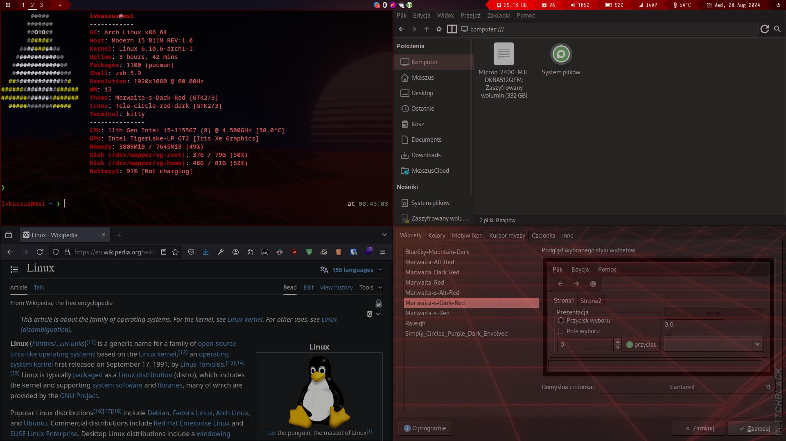

<div align="center">
<h1>My Linux Desktop Dotfiles</h1>
<p>My Linux configuration files (dotfiles) for i3 Window Manager!</p>
</div>



<h2 align="center">Arch Linux - Installation</h2>

- Install all the required packages from the `packages.txt` text file. (⚠️ Recommended to use `yay` Package Manager!)
- Adjust configuration files to your needs.
- Copy all the files and directories from the repository directories.
- Enable all the required system services.
- Restart your running Arch Linux installation.
- Enjoy! 😄️

<h2 align="center">Themes</h2>

The GTK theme and icons are not included in this branch, install them before copying the files:

- Tela Circle icons (red): package `tela-circle-icon-theme-red` on Arch, or https://github.com/vinceliuice/Tela-circle-icon-theme
- Marwaita Red GTK theme (https://github.com/darkomarko42/Marwaita-red): copy the theme folders to your themes directory:

  ```bash
  git clone https://github.com/darkomarko42/Marwaita-red.git
  mkdir -p ~/.local/share/themes
  cp -r Marwaita-red/Marwaita-* ~/.local/share/themes/
  ```

`~/.config/gtk-3.0/settings.ini` and `~/.gtkrc-2.0` select `Marwaita-Dark-Red` and `Tela-circle-red-dark`.

<h2 align="center">Credits</h2>

- This setup uses Tela Circle Icon Theme (https://github.com/vinceliuice/Tela-circle-icon-theme)
- This setup uses Marwaita Red Theme (https://github.com/darkomarko42/Marwaita-red)
- This setup uses Shapes Polybar Theme (https://github.com/adi1090x/polybar-themes)

<h2 align="center">License</h2>

This branch is licensed under GPL-3.0, see [LICENSE](LICENSE) and [THIRD_PARTY.md](THIRD_PARTY.md). Marwaita Red and Tela Circle are not included, install them from the links in THIRD_PARTY.md.
